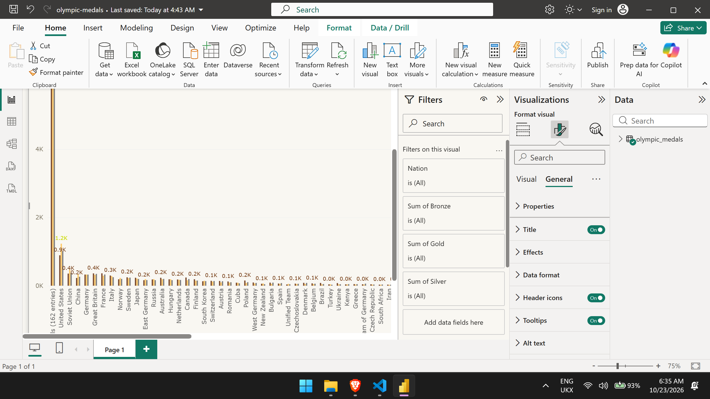

# Olympic Medals ETL Pipeline

End-to-end data pipeline that scrapes the all-time Olympic Games medal table from Wikipedia, cleans it, stores it in SQLite and CSV, runs a query, and generates a visualisation.

## What It Does

1. **Extract** — Scrapes the Wikipedia all-time Olympic medal table using `requests` and `pandas.read_html`
2. **Transform** — Cleans column names, strips footnotes, converts medal counts to integers
3. **Load** — Writes the cleaned data to a CSV file and a SQLite database
4. **Query** — Runs a SQL query to return the top 30 nations
5. **Visualise** — Generates a stacked bar chart of the top 20 nations by gold, silver, and bronze medals

## Tech Stack

- Python 3.x
- `requests` + `pandas` (scraping & data handling)
- `sqlite3` (database)
- `matplotlib` (visualisation)


## How to Run

```bash
# Install dependencies
pip install numpy pandas requests matplotlib beautifulsoup4

## Run the pipeline
python Olympic_Medals_ETL.py
## Power BI Dashboard

Interactive dashboard built in Power BI Desktop using the cleaned dataset.



Open `olympic-medals.pbix` in Power BI Desktop to explore.   
